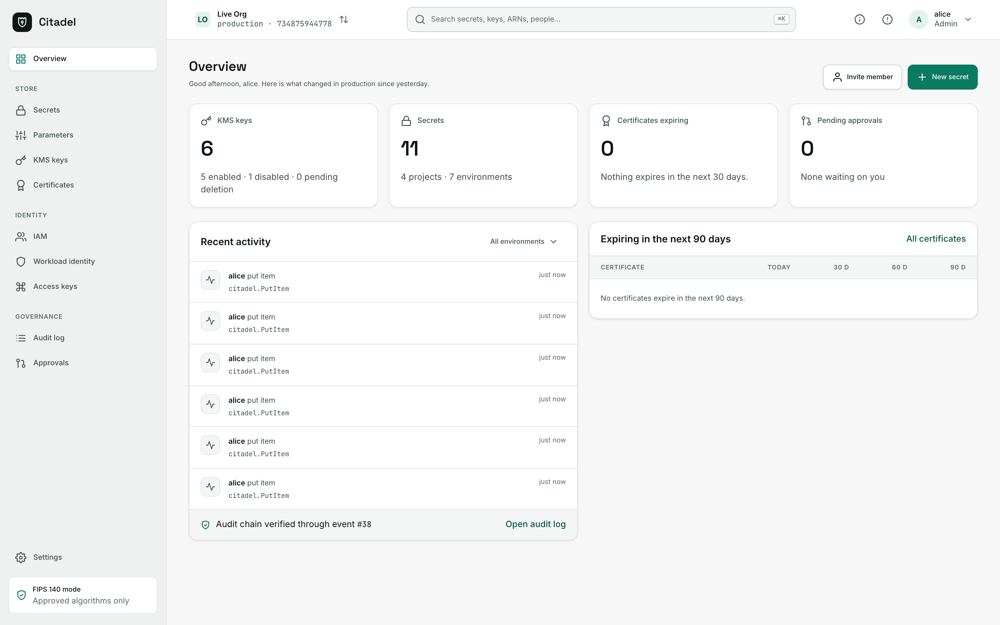
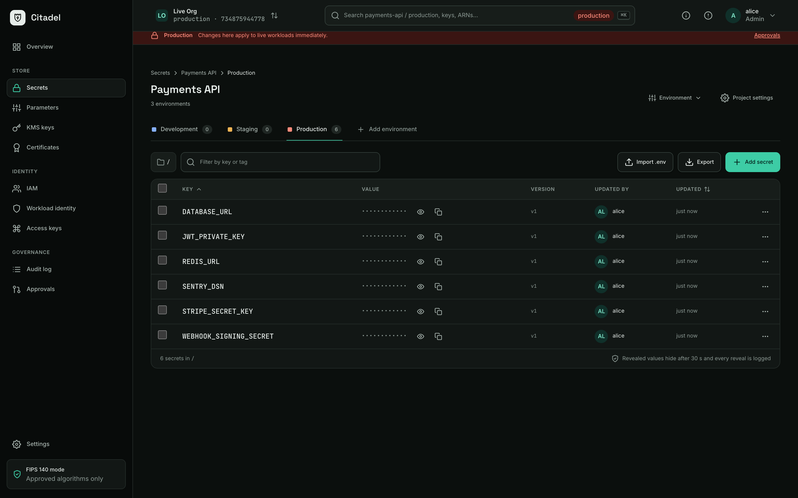
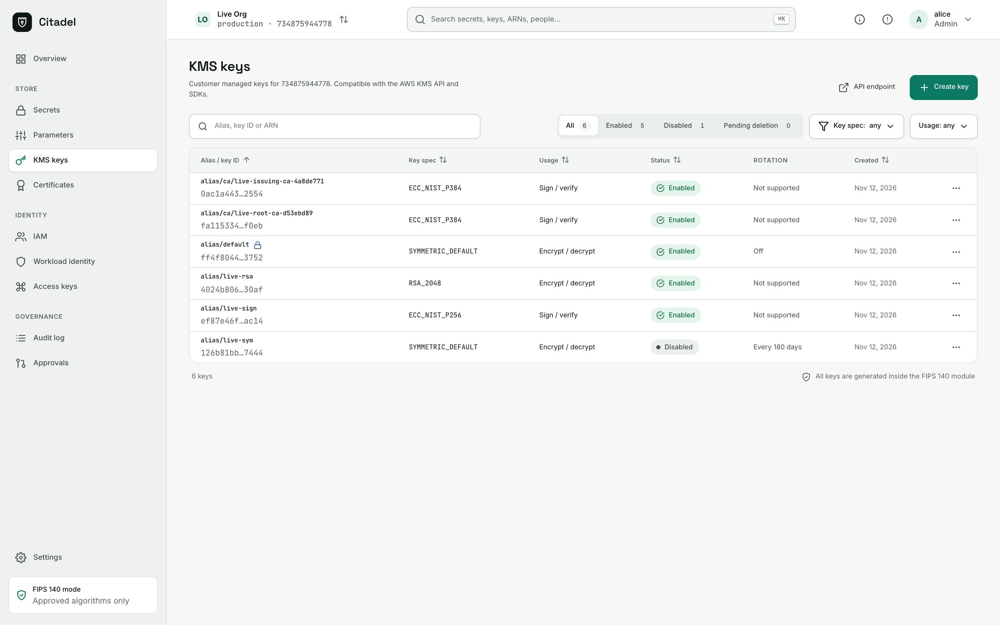

# Citadel

**A self-hosted control plane for encryption keys, secrets, certificates and
parameters, with AWS-compatible APIs and FIPS 140-3 validated cryptography.**

Point the AWS SDK, the AWS CLI, Terraform, External Secrets Operator or
Vault's `awskms` seal at Citadel, and keep your keys and secrets on
infrastructure you control.



<p align="center">
  
  
</p>

## What you get

- **KMS:** symmetric and asymmetric keys, aliases, key policies and grants,
  automatic and on-demand rotation, data keys, signing, and tags.
- **Secrets:** a project → environment → folder hierarchy in the console, kept
  as ordinary Secrets Manager secrets, so the AWS API and External Secrets
  Operator read the same data. Versions, recovery windows, tags, resource
  policies and .env import/export.
- **Approvals:** require one or more people to approve changes to sensitive
  environments. Requesters can never approve their own change.
- **Parameter Store:** String, StringList and SecureString parameters with
  history, labels and tags.
- **Private CA:** root and subordinate CAs, certificate issuance (bring a CSR
  or let Citadel generate the key), revocation and CRLs, plus Let's Encrypt.
- **ACME server:** an RFC 8555 endpoint, so cert-manager or certbot can get
  certificates from your private CA, with External Account Binding per
  account.
- **Identity:** STS (`AssumeRole`, `AssumeRoleWithWebIdentity`) with OIDC
  federation, console sign-in through your OIDC provider (Okta, Entra ID,
  Google, Keycloak), and **workload identity**: Citadel issues OIDC tokens to
  CI jobs, pods and services, signed by its own KMS keys.
- **Multi-tenant:** accounts with per-account roles (admin, editor, viewer),
  isolated data, and platform administrators.
- **Audit:** every action is recorded with who did it, from where, to what. The
  log is a per-account HMAC chain you can verify from the console or API,
  export as CSV or JSON, or stream to your SIEM.

## Security

- **FIPS 140-3.** Release images use the Go Cryptographic Module
  (`GOFIPS140=certified`) and run with `GODEBUG=fips140=only`, so non-approved
  algorithms fail at runtime. The test suite runs the same way in CI.
- **Authenticated by default.** Every AWS request needs a valid SigV4
  signature; the console needs a signed-in user. Citadel refuses to start
  without credentials configured.
- **Envelope encryption** of all key material and secrets under a wrapping key
  that never touches the database, with zero-downtime rotation.
- **Signed releases.** Images are signed with cosign (keyless) and ship with
  an SBOM and build provenance.

Read [SECURITY.md](SECURITY.md) to report a vulnerability.

## Quick start

### Docker Compose (PostgreSQL)

```bash
cd deploy/compose
./generate-env.sh       # writes .env with random secrets
docker compose up -d
docker compose logs citadel | grep -i bootstrap   # one-time setup token
```

Open http://localhost:8080/app/, enter the setup token, and create your
organization and first administrator.

### Kubernetes (Helm)

```bash
kubectl create namespace citadel
kubectl -n citadel create secret generic citadel-secrets \
  --from-literal=KMS_DB_URL='postgres://citadel:<password>@postgres:5432/citadel?sslmode=require' \
  --from-literal=KMS_WRAPPING_KEY_B64="$(openssl rand -base64 32)" \
  --from-literal=KMS_AUDIT_HMAC_KEY_B64="$(openssl rand -base64 32)"

helm install citadel deploy/helm/citadel -n citadel \
  --set secrets.existingSecret=citadel-secrets \
  --set config.publicUrl=https://citadel.example.com
```

See [docs/deployment.md](docs/deployment.md) for TLS, ingress, backups,
upgrades and verifying the signed image.

### Local development

```bash
export KMS_INSECURE_DEV=true                         # no authentication: local only
export KMS_MASTER_KEY_B64="$(openssl rand -base64 32)"
go run ./cmd/server
```

## Using it with AWS tools

Create an access key in the console (**My account → Access keys**), then:

```bash
export AWS_ACCESS_KEY_ID=AKIA...
export AWS_SECRET_ACCESS_KEY=...
export AWS_REGION=us-east-1

aws --endpoint-url https://citadel.example.com kms create-key
aws --endpoint-url https://citadel.example.com secretsmanager get-secret-value --secret-id app/prod/DATABASE_URL
```

**External Secrets Operator.** Use the `aws` provider with
`service: SecretsManager` and set ESO's `AWS_SECRETSMANAGER_ENDPOINT` (and
`AWS_STS_ENDPOINT` for service-account federation) to Citadel. Secrets created
in the console at `project/env/KEY` can be read individually or all at once:

```yaml
dataFrom:
  - find:
      name:
        regexp: "^payments/prod/"
    rewrite:
      - regexp: { source: "payments/prod/(.*)", target: "$1" }
```

**Vault auto-unseal:**

```hcl
seal "awskms" {
  region     = "us-east-1"
  kms_key_id = "alias/vault-unseal"
  endpoint   = "https://citadel.example.com"
}
```

Supported actions and known differences from AWS are listed in
[docs/aws-compatibility.md](docs/aws-compatibility.md).

## Documentation

| Topic | Where |
|---|---|
| Every configuration setting | [docs/configuration.md](docs/configuration.md) |
| Production deployment | [docs/deployment.md](docs/deployment.md) |
| AWS API compatibility | [docs/aws-compatibility.md](docs/aws-compatibility.md) |
| Security model | [docs/security-model.md](docs/security-model.md) |
| Release notes | [CHANGELOG.md](CHANGELOG.md) |

## Project layout

| Path | Contents |
|---|---|
| `cmd/server` | The Citadel binary: configuration, storage and server wiring |
| `internal/server` | HTTP routing, middleware and handlers for the AWS-compatible and native APIs |
| `internal/store` | Domain types and storage interfaces, with `postgres` (versioned migrations) and `memory` backends |
| `internal/acme`, `internal/oidclogin`, `internal/workloadid`, `internal/jose` | ACME server, OIDC sign-in, workload identity issuer, JWS/JWT |
| `internal/config`, `internal/sigv4`, `internal/cryptoutil`, `internal/metrics` | Configuration, SigV4 verification, crypto helpers, Prometheus exporter |
| `web` | The SvelteKit web console |
| `deploy` | Helm chart and Docker Compose stack |
| `sdk` | Go client library |

## Contributing

Contributions are welcome. Start with [CONTRIBUTING.md](CONTRIBUTING.md) for
setup and the checks a change has to pass, and follow the
[Code of Conduct](CODE_OF_CONDUCT.md).

## License

GNU Affero General Public License v3.0 or later (`AGPL-3.0-or-later`). See
[LICENSE](LICENSE). By contributing you agree to license your contributions
under the same terms.
